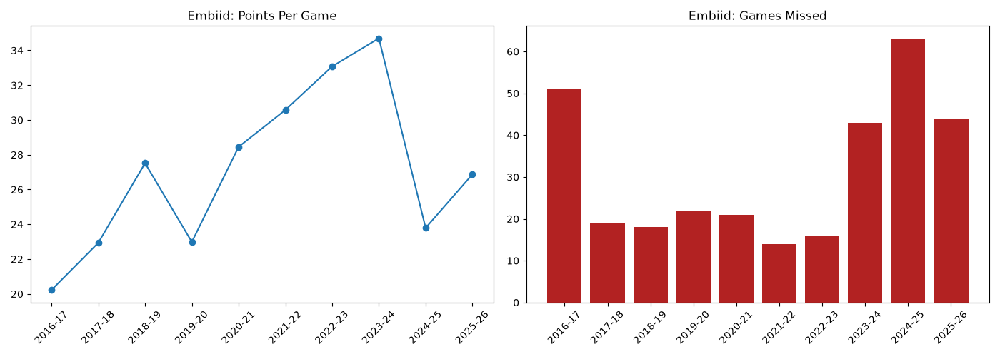

# embiid-analytics
Python analysis of Joel Embiid’s career scoring, efficiency, and availability using pandas, matplotlib, and the NBA API# Joel Embiid Career Analytics

Python analysis of Joel Embiid's career scoring, efficiency, and availability using pandas, matplotlib, and the NBA API.

## Question
How have Joel Embiid's production and games played changed across his career?

## Key Findings
- His highest scoring season was 2023-24 at 34.7 points per game.
- He missed the most games in 2024-25, missing 63 games.
- His True Shooting % rose from 58.4% in 2016-2017 to 60.5% in 2025-26, peaking at 65.5% in 2022-23.

## Chart

## Tools
Python, pandas, matplotlib, nba_api

## How to run
pip install nba_api pandas matplotlib
python embiid_stats.py
